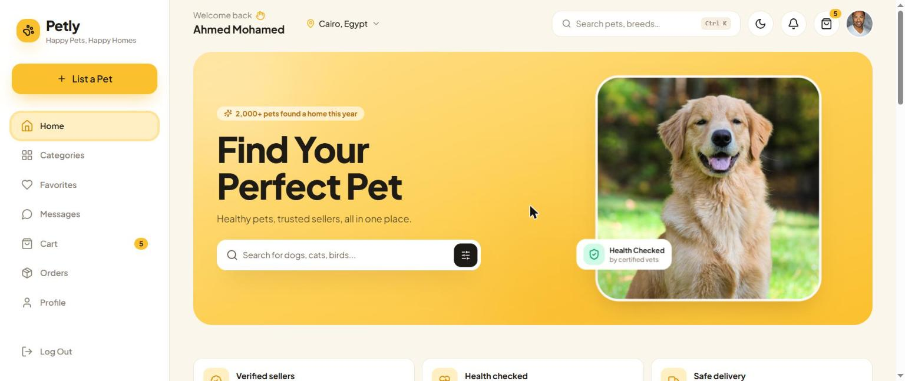
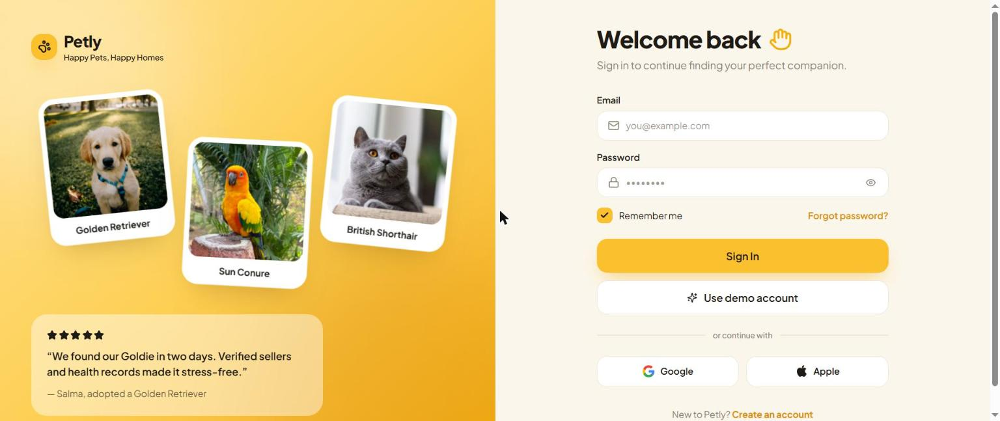
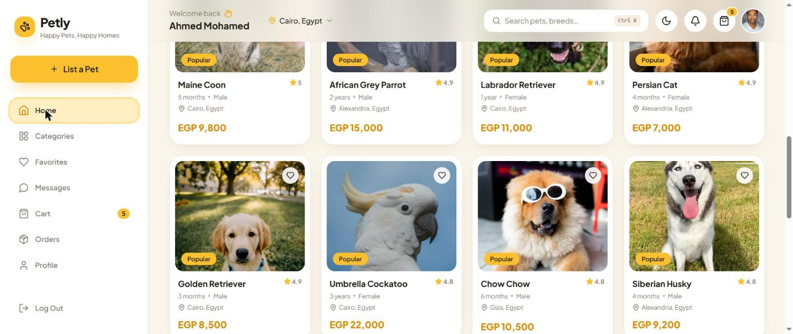
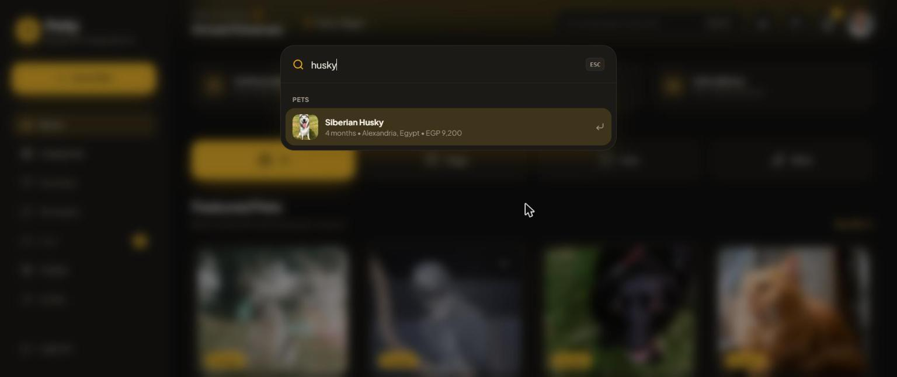
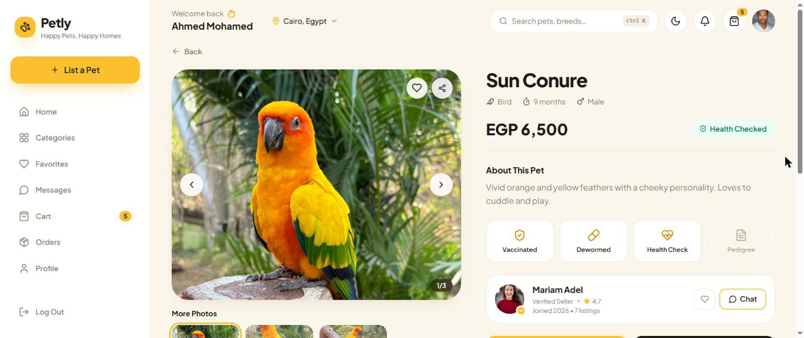
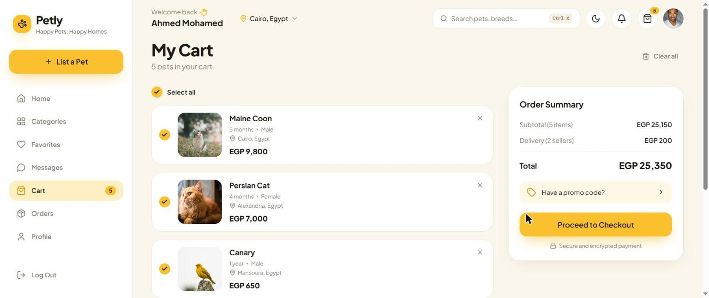
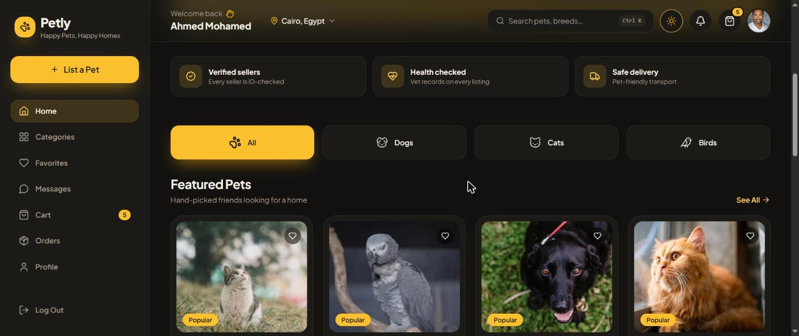

# 🐾 Petly — Happy Pets, Happy Homes

A friendly marketplace for buying and selling pets. People can browse dogs, cats and birds, save their favorites, chat with sellers, and list their own pets — all in a warm, playful interface that feels good to use.

**🔗 Live demo:** [petly-pets.vercel.app](https://petly-pets.vercel.app)

On the login page, click **Use demo account** to look around without signing up.



## Signing in

The login page shows floating pet cards and a customer quote on one side, and a clean form on the other. The form checks your input as you type, and the sign-up page shows how strong your password is.



## Finding a pet

- **Home**: a big welcome banner, quick filters for dogs, cats and birds, and featured pets.
- **Categories**: browse by type and filter the list. Filters live in the page link, so you can share a search or refresh without losing it.
- **Search anywhere**: press **Ctrl + K** (or **⌘ + K** on Mac) to open a quick search for pets and pages.





## Pet details

Each pet has its own page with a photo gallery (swipe or open it full screen), age, price, health information and the seller's profile.



## Cart and checkout

Pick the pets you want, change quantities, try a promo code (`PETLY10` or `HAPPYPET`), and check out with a little confetti at the end.



## More features

- **List a Pet**: the yellow **+** button lets anyone publish a new listing with photos.
- **Favorites, Orders and Profile** pages for each user.
- **Messages and notifications** between buyers and sellers.
- **Dark mode** that remembers your choice.



## Nice touches

- An animated welcome screen while the app loads.
- Soft loading placeholders for every section and image.
- Pet cards tilt and shine when you hover over them.
- Smooth page transitions and small animations everywhere, with less motion for people who prefer it.
- Works on phones, tablets and computers.

## Built with

- **Front end:** React 19, Tailwind CSS v4, Framer Motion, React Router
- **Back end:** Express and MongoDB, with JWT sign-in
- **Hosting:** Vercel

## Run it on your computer

You need Node.js and a MongoDB database.

```bash
# 1) The API — first create server/.env with:
#    PORT, MONGO_URI, JWT_SECRET, JWT_EXPIRE, CLIENT_URL
cd server
npm install
npm run seed
npm run dev        # http://localhost:5000

# 2) The website — in a new terminal, from the project folder
npm install
npm run dev        # http://localhost:5173
```

Demo account: `demo@petly.com` / `petly123`

<details>
<summary><b>Project structure</b></summary>

```
src/
├── components/
│   ├── ui/          # Buttons, inputs, modals, skeletons, images…
│   ├── layout/      # Sidebar, top bar, mobile menu, command palette
│   ├── pets/        # Pet cards, grid, gallery, category filter
│   ├── cart/        # Cart items, order summary, checkout
│   ├── auth/        # Shared login / sign-up parts
│   ├── profile/     # Profile cards and menu
│   └── feedback/    # Toasts and page loader
├── config/          # navigation.js — one place for all menus
├── context/         # Auth, theme, toasts, cart, favorites
├── data/            # Categories, breeds and showcase content
├── hooks/           # useAsync, useForm, useDebounce, useHotkey…
├── layouts/         # Auth and dashboard layouts
├── lib/             # Helpers: formatting, storage, validation
├── pages/           # One file per page (loaded on demand)
├── routes/          # App router and protected routes
└── services/        # API calls: auth, pets, cart, favorites, orders
```

</details>

<details>
<summary><b>Deploying to Vercel</b></summary>

The website and the API deploy together as one Vercel project. `vercel.json` builds the site, installs the `server/` packages, and sends every `/api/*` request to `api/index.js`, which runs the Express app on the same domain.

In the Vercel project:

1. **Environment variables:** `MONGO_URI`, `JWT_SECRET` (optional: `RESEND_API_KEY`, `EMAIL_FROM`, `CLIENT_URL`).
2. **Storage → Blob:** create a store and connect it, so pet photos can be uploaded.
3. **MongoDB Atlas → Network Access:** allow `0.0.0.0/0`, because Vercel has no fixed IP addresses.

Vercel can't keep live socket connections open, so chat and notifications check for updates every few seconds instead (`hooks/usePolling.js`). Typing indicators only appear when running locally.

</details>

---

Made by **Samaa Abo Diab** · [LinkedIn](https://www.linkedin.com/in/samaa-abo-diab)
